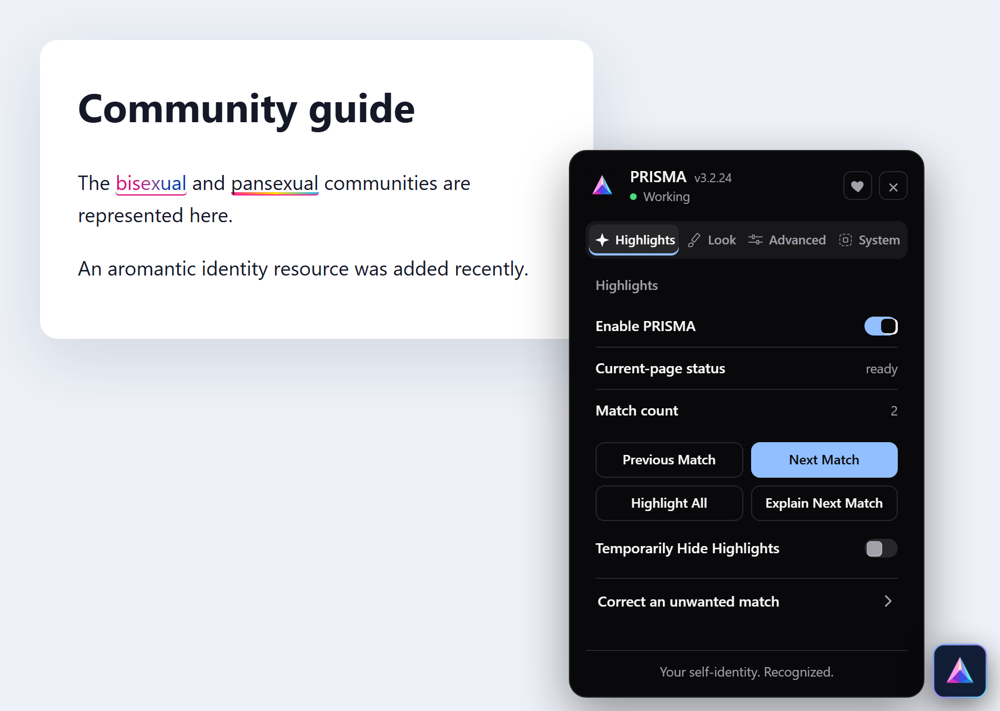
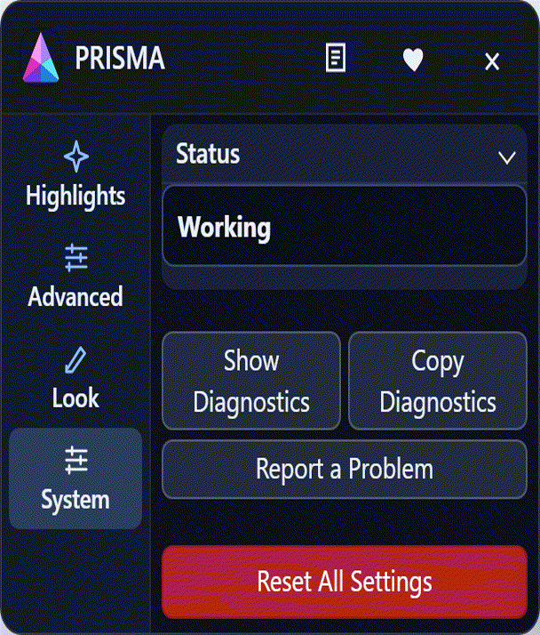

#  PRISMA

Highlight LGBTQ+ identity terms in their flag colors and explore their definitions and sources.

[Install PRISMA](https://github.com/ExtraPotions/PRISMA/releases/latest/download/prisma.user.js) · Requires [Violentmonkey](https://violentmonkey.github.io/get-it/) or [Tampermonkey](https://www.tampermonkey.net/).

After installing, refresh a page and open the PRISMA gem. [Setup and controls →](docs/usage.md)

## Features

- Find identity terms in context, with ambiguous matches held back.
- Open definitions and sources, or ignore an unwanted phrase on that site.
- Choose gradients, underlines or soft fills, with optional animation.
- Browse the identity catalog and choose where highlighting runs.

Known banking, healthcare and email sites stay unchanged unless you enable PRISMA for that site.

## See it in action

More screenshots

Screenshots use sample content.

---

[Usage](docs/usage.md) · [Changelog](CHANGELOG.md) · [Support](https://ko-fi.com/expdare) · [Code license](LICENSE-CODE.md) · [Artwork and documentation license](LICENSE-ASSETS.md)

Donations are optional. All features remain available without donating.

PRISMA is independent and is not affiliated with or endorsed by the websites where it is used.
