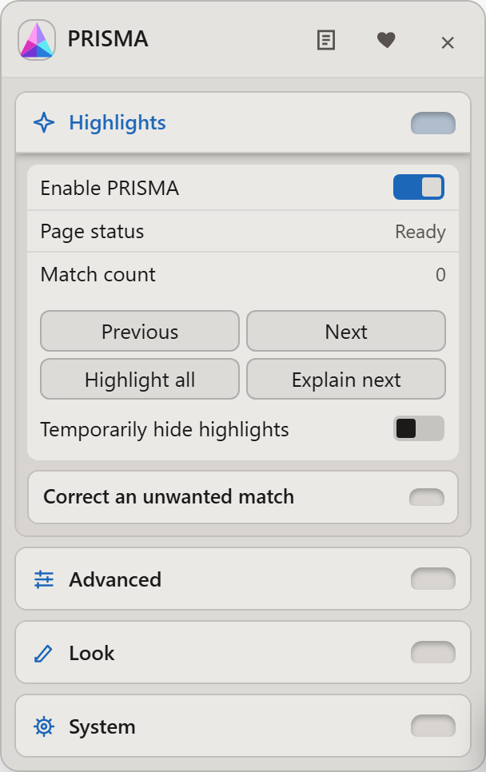
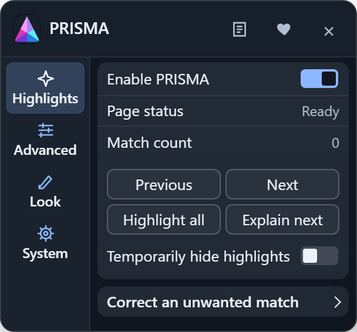
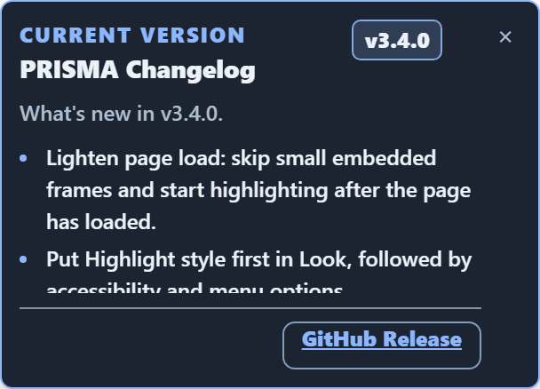

#  PRISMA

> **Retired — 2026-11-13.** PRISMA is no longer maintained and gets no further updates. Its releases, history and source stay available for reference.

Highlight LGBTQ+ identity terms in their flag colors and explore their definitions and sources.

[Install PRISMA](https://github.com/ExtraPotions/PRISMA/releases/latest/download/prisma.user.js) · Requires [Violentmonkey](https://violentmonkey.github.io/get-it/) or [Tampermonkey](https://www.tampermonkey.net/).

After installing, refresh a page and open the PRISMA gem. [Setup and controls →](docs/usage.md)

## Features

- Find identity terms in context, with ambiguous matches held back.
- Open definitions and sources, or ignore an unwanted phrase on that site.
- Choose gradients, underlines or soft fills, with optional animation.
- Browse the identity catalog and choose where highlighting runs.

Known banking, healthcare and email sites stay unchanged unless you enable PRISMA for that site.

## Screenshots

| Light | Dark | Changelog |
| :---: | :---: | :---: |
|  |  |  |

---

[Usage](docs/usage.md) · [Changelog](CHANGELOG.md) · [Support](https://ko-fi.com/expdare) · [Code license](LICENSE-CODE.md) · [Artwork and documentation license](LICENSE-ASSETS.md)

Donations are optional. All features remain available without donating.

PRISMA is independent and is not affiliated with or endorsed by the websites where it is used.
Menus use Slate Blue in Light, Dark or System mode.
